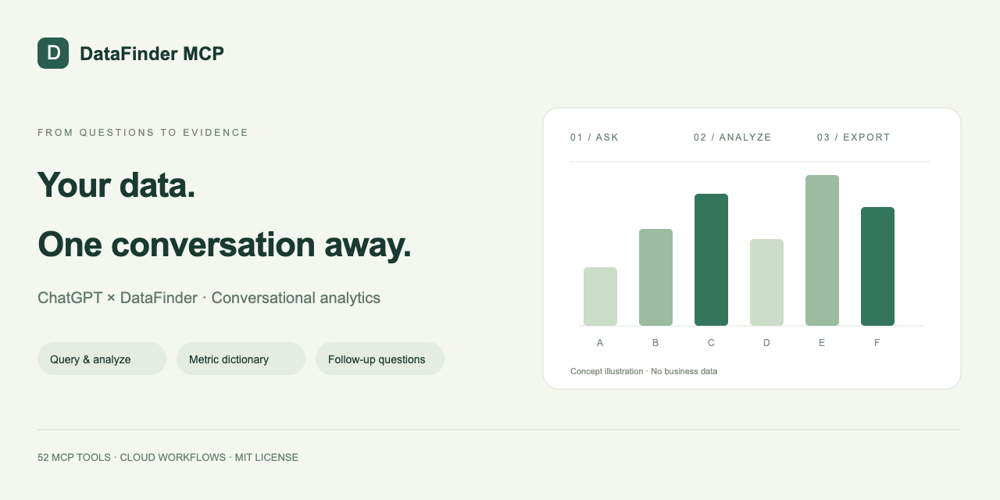

# DataFinder MCP — ChatGPT Analytics for Volcengine DataFinder

Saved SQL metrics now support explicit dictionary table/column bindings and unified preview → execution → row-limit follow-ups. Saved dates are preserved; temporary date/filter overrides are not supported. Legacy metrics require a reviewed binding before execution.

[npm](https://www.npmjs.com/package/@cyuanxv/datafinder-mcp) · [MCP Registry](https://registry.modelcontextprotocol.io/v0.1/servers/io.github.cyuanxv%2Fdatafinder-mcp/versions/0.2.5)

[简体中文](README.md) | **English**



**Turn your DataFinder into an AI analytics workspace you can talk to.**

DataFinder MCP connects Volcengine DataFinder to ChatGPT so product managers, growth teams, and data analysts can query reports, explore user retention, analyze conversion funnels, compare metrics, and export results using natural language. Go from “show me the numbers” to “break that down by channel” in one continuous conversation.

Built around the Model Context Protocol (MCP), the project provides **52 tool interfaces** for data queries, analytics, metric dictionaries, task history, and controlled configuration changes. Once deployed in the cloud, the service runs without keeping your personal computer online.

> **Move from business questions to answers you can trace, check, and build on.**

Saved SQL supports existing event-date bindings with a fixed preview. Re-preview after the Shanghai date or saved definition changes. Temporary argument overrides are unsupported. Cloud deployments can run independently of your personal computer; a locally installed npm worker requires its host to stay running.

## Install the full 52-tool edition

The **0.2.5 standalone package** includes all 52 tools, its own SQLite database, persistent jobs and a separate background worker. Local and upstream writes are disabled by default; enabled changes still require preview, confirmation and readback. **Node.js 24+ is required.**
Saved SQL supports output-column candidates, explicit table/column selection, and fixed previews before read-only execution. Saved dates and SQL stay unchanged. CTE output labels are candidates, not inferred business metrics.


[English standalone installation](standalone/README.en.md) · [Installation troubleshooting](docs/TROUBLESHOOTING.en.md) · [中文安装](standalone/README.md) · [All 52 tools](standalone/TOOLS.md)

| Choose a route | What it runs |
|---|---|
| Standalone MCP package | Local stdio clients, independent SQLite, your own background worker |
| Web workbench | Separate cloud deployment with D1 and an authentication gateway; needed for ChatGPT web's remote connection |
| Browser demo below | Preset questions and fictional data; no MCP client connection |

Install with `npm install @cyuanxv/datafinder-mcp@0.2.5`, or launch with `npx -y @cyuanxv/datafinder-mcp@0.2.5` after configuring the environment in the standalone guide.

## See it work. Then try it yourself.

**[Watch the demo (43 seconds)](https://github.com/user-attachments/assets/9ee2402d-c30d-40fc-82c7-02d2f36ef238)** · [Download MP4](assets/datafinder-mcp-demo.zh.mp4) · [Chinese subtitles](assets/datafinder-mcp-demo.zh.srt) · [Installation troubleshooting](docs/TROUBLESHOOTING.en.md)

https://github.com/user-attachments/assets/9ee2402d-c30d-40fc-82c7-02d2f36ef238

1080p, Chinese captions, no audio. Follow a preset question, view channel results, filter to iOS, and export CSV. The video uses fictional data and edited screenshots of actual local demo interactions; it is not a live ChatGPT session.

This is an actual screenshot of the local demo, using entirely fictional data. Run a guided query, filter to iOS, and export CSV. It does not connect to ChatGPT or a live DataFinder account.


[English installation and demo guide](docs/INSTALL.en.md) · [中文教程](docs/INSTALL.zh-CN.md)

```sh
cd site
npm ci
npm run demo
```

Open `http://127.0.0.1:4178/?lang=en` when prompted. The first installation needs registry access; the demo requires no API keys and uses the project's actual analysis validation and export code.

## Start an analysis with a sentence

After connecting your own account and configuring access, try asking ChatGPT:

- “Show yesterday’s active users, broken down by channel and operating system.”
- “Compare next-day retention for new users with the previous week.”
- “Analyze the conversion funnel from app open to successful payment, with a one-day window.”
- “Show today’s event count so far, grouped by hour.”
- “Keep the same filters, focus on iOS, and export the results.”
- “Add this metric to the dictionary. Show me its definition and a preview first.”

ChatGPT interprets the request and calls the tools. The workspace validates parameters, runs queries, and returns sources and data-quality notes. Specify what terms such as “new user,” “revenue,” and “conversion” mean for your business so the analysis uses the intended definitions.

## A toolkit for everyday product analytics

| Capability | What you can do |
|---|---|
| Natural-language data queries | Find reports, query metrics, and add filters or breakdowns from ChatGPT |
| User behavior analytics | Work with event, retention, conversion funnel, distribution, and lifecycle analysis |
| Intraday and hourly analysis | Query today’s data so far, hourly results, or a specific time window |
| Metric dictionary | Save metric names, definitions, sources, and versions for reuse |
| Follow-up analysis | Carry forward existing conditions, preview changes, and run the next query |
| Formulas and comparisons | Combine metrics and compare periods or segments while retaining context |
| Report exports | Export CSV and Excel-readable formats for reviews and collaboration |
| Cloud tasks and history | Track task progress, saved query conditions, and previous versions |
| Configuration management | Preview, confirm, and read back changes to supported metadata, virtual objects, and rule-based cohorts |

Available parameters and features depend on the implementation, upstream APIs, and your account permissions. See [Feature boundaries](#feature-boundaries) below.

## Keep the definitions. Continue the conversation. Check the evidence.

**Give your metrics a shared definition.** Save numerators, denominators, deduplication rules, and sources in a versioned metric dictionary instead of explaining them from scratch for every query.

**Build on the previous question.** Move from overall performance to channels and platforms while keeping your analysis conditions. Review the differences before running the next step.

**Keep answers grounded in their sources.** Query sources, date ranges, and quality notes stay with the results. Missing, failed, and incomplete responses have explicit states to help you assess what the data supports.

**Make configuration changes visible.** Preview a change, confirm it, then read back the result to check what was saved.

## Who is it for?

- **Product managers:** Explore feature usage, retention, and key conversion journeys.
- **Growth and operations teams:** Break down performance by channel, platform, or user conditions and export results for review.
- **Data analysts:** Maintain metric definitions, reuse analysis conditions, and check results against their intended scope.
- **AI tool developers:** Explore how DataFinder OpenAPI connects to MCP and extend your own analytics workflows.

## Frequently asked questions

### Can ChatGPT query DataFinder directly?

ChatGPT can call the integrated data tools through this project's MCP service. You need to deploy the service, configure your own DataFinder account, and connect it in ChatGPT. Availability also depends on the client's MCP support and your account permissions.

### Can I analyze data without writing SQL?

For supported reports and analyses, including events, retention, and funnels, describe your question in natural language and let ChatGPT call the corresponding tools. Complex business questions still require clear metric definitions and data sources. The project does not provide unrestricted arbitrary SQL execution.

### Does my computer need to stay on?

Once deployed in the cloud, the query service runs there independently of your personal computer. Initial deployment and configuration are your responsibility.

### Does the source include someone else's data or API keys?

No. The source includes fictional examples only. Bring your own account, database, and permissions. Store credentials in your MCP client's secure environment configuration or your server's secret store.

## Checks and validation

The current code has passed **459 automated tests, 36 standalone integration checks, TypeScript type checking, and a production build**. Tests were also rerun on the extracted source archive. The automated suite and demo use simulated data. Separate limited live read-only acceptance passed; this does not establish compatibility with every tenant or deployment platform.

## Run checks locally

Use Node.js 24 LTS, npm, and Python 3 for the signature compatibility test. The standalone package requires Node.js 24+. The commands below check the web-workbench source in `site`.

```sh
cd site
npm ci
npm test
npm run typecheck
npm run build
```

Tests use injected mock responses and block live requests through global `fetch` by default. No credentials are required. Do not connect a production database just to run tests.

Use `npm run dev` to start the local development server. The project retains a Sites / Cloudflare D1 architecture, and page authentication depends on the platform gateway. A normal local start may redirect to a sign-in endpoint. A successful build does not establish that deployment on another platform is complete. Do not expose the development server to the public internet.

## Configure the cloud web workbench

For the standalone package, follow [the English standalone guide](standalone/README.en.md): environment-based scope, an independent SQLite file and stdio. The D1 and gateway steps below apply to the cloud web workbench.

1. Edit [`site/lib/datafinder/scope-config.mjs`](site/lib/datafinder/scope-config.mjs) with your project, application, subject, dashboard, and report IDs, plus your `PUBLIC_BASE_URL`. All bundled IDs are fictional placeholders.
2. Set `DATAFINDER_AK`, `DATAFINDER_SK`, and `DATAFINDER_OWNER_USER_ID` in your server's secret configuration. See [`site/.env.example`](site/.env.example) for variable names. Never commit real credentials to Git.
3. Provision a separate D1 database bound as `DB` and apply the migrations in [`site/drizzle/`](site/drizzle/) to that new database. Do not connect someone else's existing database.
4. Configure a trusted authentication gateway. It must validate identity, strip externally supplied `oai-authenticated-*` headers, and inject verified identity headers. Prevent direct access to the origin that bypasses the gateway. Protected API calls require a matching configured owner. See [`SECURITY.md`](SECURITY.md).
5. Validate each feature using your own test account. The default API host is `analytics.volcengineapi.com`; verify requirements for other regions, plans, and API permissions. [`site/.openai/hosting.json`](site/.openai/hosting.json) contains no existing deployment's `project_id`.

Keep `DATAFINDER_ALLOW_PROJECT_WIDE=false` until you explicitly intend to authorize project-wide queries. The code retains preview, confirmation, and readback steps. Metadata and cohort changes can affect upstream configuration. Do not automatically approve write requests.

## Feature boundaries

- The source retains query, filter, dictionary, formula, condition versioning, report export, and management functionality.
- Example metric definitions and business rules are unconfirmed by default. Define them for your own use case.
- Tags, business dimensions, and some native report management capabilities depend on vendor plans, permissions, or APIs that have not yet been verified. A listed capability does not mean it is available to every tenant.
- Standalone acceptance covers 36 installation/integration checks and limited live read-only queries, background execution and downloads. This does not establish every vendor endpoint, tenant, cloud-page deployment or native ChatGPT web connection. Upstream-write acceptance used fictional data only.

## Before publication

This package contains no `.git` directory, remote repository configuration, or previous author history. If you publish it, initialize a new repository from these files instead of copying the original Git history.

This project is licensed under the [MIT License](LICENSE), with copyright attributed to cyuanxv. Third-party code and dependencies retain their own licenses; see [Third-party notices](THIRD-PARTY-NOTICES.md).

## Author and community

Twitter / X: [@cyuanxv](https://x.com/cyuanxv)

Connect to discuss DataFinder, conversational analytics with ChatGPT, and MCP tool development.

[GitHub repository description, topics and social preview setup](docs/GITHUB-SETUP.md)

[Full standalone MCP package (52 tools, SQLite storage and background jobs): installation, configuration and Registry metadata](standalone/README.en.md)

[Account verification and release checklist](docs/RELEASING.en.md)

[Analysis acceptance boundaries / 分析验收范围](docs/ANALYSIS-CONTRACTS.md)
