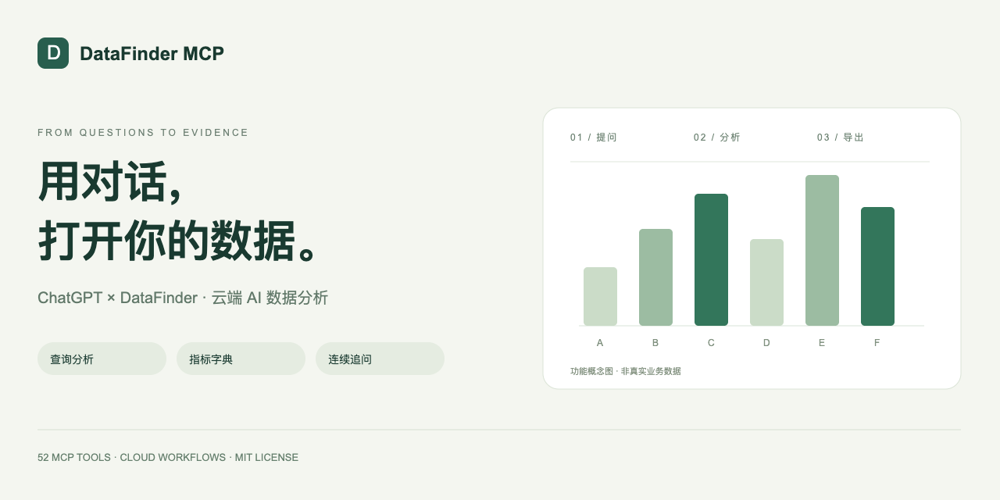

# DataFinder MCP｜用 ChatGPT 分析火山引擎数据

**简体中文** | [English](README.en.md)



**把你的 DataFinder，变成随时可以对话的 AI 数据分析工作台。**

DataFinder MCP 将火山引擎 DataFinder 接入 ChatGPT，让产品、运营和数据分析师用自然语言查报表、分析留存、拆解转化漏斗、对比指标，并把分析结果导出为报告。从“帮我查一下”到“继续按渠道拆开看”，让数据分析在一段对话里持续推进。

通过 MCP（Model Context Protocol，模型上下文协议）连接 AI 与数据工具，提供 **52 个工具入口**，覆盖查询、分析、指标字典、任务记录和受控配置管理。服务部署在云端后，无需让个人电脑一直开着。

> **让每一个业务问题，都能更快走到有依据的答案。**

DataFinder MCP connects Volcengine DataFinder to ChatGPT for conversational analytics, retention analysis, conversion funnels, metric dictionaries, and report exports.

## 安装完整 52 工具版

**0.2.0 独立安装包**包含完整 52 个工具、独立 SQLite 数据库、持久任务和单独运行的后台程序。默认关闭本地及上游修改，启用后仍需预览、确认和回读。**需要 Node.js 24 或更高版本。**

[中文独立安装教程](standalone/README.md) · [English installation](standalone/README.en.md) · [52 工具清单](standalone/TOOLS.md)

| 选择哪种方式 | 运行什么 |
|---|---|
| 独立 MCP 安装包 | 本机 stdio 客户端、独立 SQLite 和自己的后台程序 |
| 网页工作台 | 单独的云端部署、D1 和登录网关；ChatGPT 网页连接需要远程服务 |
| 下方浏览器演示 | 预设问题和虚构数据，不建立 MCP 客户端连接 |

安装包：`npm install @cyuanxv/datafinder-mcp@0.2.0`。也可用 `npx -y @cyuanxv/datafinder-mcp@0.2.0` 启动；请先按独立安装教程配置环境变量。

## 先看一遍，再亲手试试

下面是本地演示的真实截图，全部使用虚构数据。点击预设问题，执行分析、筛选 iOS 并导出 CSV；不连接 ChatGPT 或真实 DataFinder 账户。


[中文安装与演示教程](docs/INSTALL.zh-CN.md) · [English setup guide](docs/INSTALL.en.md)

```sh
cd site
npm ci
npm run demo
```

打开终端提示的 `http://127.0.0.1:4178/?lang=zh`。首次安装需要网络；演示执行无需密钥，使用项目实际的分析校验和导出代码。

## 用一句话，开启一轮数据分析

接入自己的账户并配置好权限后，可以在 ChatGPT 中这样提问：

- “查一下昨天的活跃用户，按渠道和系统拆开看。”
- “看看新用户的次日留存，和上一周对比。”
- “分析从打开应用到支付成功的转化漏斗，窗口设为一天。”
- “查看今天截至当前的事件次数，按小时展示。”
- “沿用刚才的条件，只看 iOS，再把结果导出。”
- “把这个指标加入字典，先给我看定义和预览。”

ChatGPT 负责理解问题和调用工具，工作台负责校验参数、执行查询、返回来源及质量提示。涉及“新用户”“收入”“转化”等业务定义时，可以明确指定口径，避免把不同含义的数据混在一起。

## 为日常分析准备的一整套工具

| 能力 | 能帮你做什么 |
|---|---|
| 自然语言查数 | 在 ChatGPT 中检索报表、查询指标、增加筛选和分组 |
| 用户行为分析 | 使用事件、留存、转化漏斗、分布、生命周期等分析能力 |
| 当天与小时分析 | 查看当天截至当前的数据，按小时或指定时段查询 |
| 指标字典 | 保存名称、口径、来源和版本，让后续分析有定义可循 |
| 连续追问 | 继承已有条件，预览改动，再按新条件继续分析 |
| 公式与结果对比 | 组合指标、对比时段与分组，并保留解释所需的上下文 |
| 分析报告导出 | 导出 CSV、Excel 可读格式，方便复盘与协作 |
| 云端任务与记录 | 保存任务进度、查询条件和历史版本，方便回看 |
| 配置管理 | 对支持的元数据、虚拟对象和规则分群先预览、再确认、再回读 |

各分析类型的参数覆盖和可用性以实现、上游接口及账户权限为准，详细限制见下方“功能边界”。

## 查得到，更要看得懂、追得回

**把指标定义留住。** 不必每次从头解释分子、分母和去重规则；通过指标字典保存口径和来源，后续按版本使用。

**让追问接得上。** 从总体到渠道、从渠道到平台，沿用前一次的分析条件，查看差异后继续执行。

**让结果有据可查。** 保留查询来源、日期范围和质量提示，对缺失、失败或不完整结果给出明确状态，帮助核对结论。

**让修改看得见。** 配置变更先展示预览，确认后执行，再读取结果核对，减少误改。

## 适合谁使用？

- **产品经理**：分析功能使用、留存和关键转化链路。
- **增长与运营团队**：按渠道、平台或用户条件拆解表现，导出复盘数据。
- **数据分析师**：维护指标定义、复用分析条件、核对结果与口径。
- **AI 工具开发者**：参考 DataFinder OpenAPI 与 MCP 的连接方式，扩展自己的数据分析工作流。

## 常见问题

### 可以在 ChatGPT 里直接查询 DataFinder 吗？

可以通过本项目提供的 MCP 服务调用已接入的数据工具。使用前需要部署服务、配置自己的 DataFinder 账户，并在 ChatGPT 中连接；可用性也取决于客户端的 MCP 支持和账户权限。

### 不写 SQL 也能分析数据吗？

对于已覆盖的报表、事件、留存和漏斗等分析，可以用自然语言描述需求，由 ChatGPT 调用对应工具。复杂业务仍需要明确指标定义和数据来源；项目不提供不受限制的任意 SQL 执行。

### 需要一直开着电脑吗？

部署到云端后，查询服务在云端运行，不依赖个人电脑持续开机。首次部署和配置需要自行完成。

### 会附带别人的数据或密钥吗？

不会。源码只附虚构示例；使用者需要配置自己的账户、数据库和权限。真实密钥只应保存在 MCP 客户端的安全环境配置或服务器秘密配置中。

## 检查与验证

当前源码通过 **441 项自动化测试、27 项独立版集成检查、TypeScript 类型检查和生产构建**，源码包解压后也完成测试复核。自动化测试和演示使用模拟数据，另完成有限的真实只读验收；这些结果不代表每个租户或部署平台均已验证。

## 本地检查

建议使用 Node.js 24 LTS、npm 和 Python 3（签名兼容性测试需要）。独立包至少要求 Node.js 24；下面的命令用于检查 `site` 中的网页工作台源码。

```sh
cd site
npm ci
npm test
npm run typecheck
npm run build
```

测试使用注入的模拟响应，默认禁止全局 fetch 访问真实接口。无需提供任何密钥。不要为了运行测试接入生产数据库。

`npm run dev` 可启动本地开发服务器。项目沿用 Sites / Cloudflare D1 架构，页面认证依赖平台网关，普通本地启动可能跳到登录入口。构建成功不等于已完成独立平台部署。请勿把开发服务器暴露在公网。

## 配置云端网页工作台

独立安装包请按[独立安装教程](standalone/README.md)设置环境变量、独立 SQLite 和 stdio 连接。下面的 D1 和登录网关步骤只适用于云端网页工作台。

1. 修改 [site/lib/datafinder/scope-config.mjs](site/lib/datafinder/scope-config.mjs)：填写自己的项目、应用、主体、看板和报表编号，以及 PUBLIC_BASE_URL 访问地址。当前编号全部是虚构占位值。
2. 在服务器的秘密配置中设置 `DATAFINDER_AK`、`DATAFINDER_SK` 和 `DATAFINDER_OWNER_USER_ID`。变量说明见 [site/.env.example](site/.env.example)，不要把真实值提交到 Git。
3. 提供独立的 D1 数据库绑定 `DB`，在新数据库应用 [site/drizzle/](site/drizzle/) 迁移。不要连接他人的现有数据库。
4. 配置可信认证网关：它必须验证用户身份、清除外部伪造的 `oai-authenticated-*` 请求头，再注入可信身份；禁止绕过网关访问源站。接口要求绑定的账号匹配。详见 [SECURITY.md](SECURITY.md)。
5. 使用自己的测试账户逐项验收。默认 API 域名为 `analytics.volcengineapi.com`；其他地区、套餐和 API 权限需自行确认。[site/.openai/hosting.json](site/.openai/hosting.json) 没有任何现有部署的 project_id。

保持 `DATAFINDER_ALLOW_PROJECT_WIDE=false`，直到明确需要授权整个项目的查询范围。代码保留预览、确认与回读功能；执行元数据或分群变更可能改变上游配置。不要自动确认写入请求。

## 功能边界

- 保留查询、筛选、字典、公式、条件版本、报告导出及管理功能的代码。
- 示例字典、业务口径默认未确认，需要使用者自行定义。
- 标签、业务维度、某些原生报表管理能力依赖厂商套餐、权限或尚未验证的接口。请勿将目录中出现的功能理解为所有租户都已可用。
- 独立版已完成 27 项安装与集成检查，以及有限的真实只读查询、后台执行和下载验收；不代表每个火山接口、租户、云端页面或 ChatGPT 网页连接均已验收。上游修改只用虚构数据测试。

## 发布前

本包不含 `.git`，没有远程仓库地址或旧作者历史。需要发布时，应从这份源码新建仓库，不能复制原项目的 Git 历史。

本项目采用 [MIT License](LICENSE)，版权署名为 cyuanxv。第三方代码与依赖继续适用各自的许可证，详见 [第三方声明](THIRD-PARTY-NOTICES.md)。

## 作者与交流

Twitter / X：[ @cyuanxv ](https://x.com/cyuanxv)

欢迎交流 DataFinder、ChatGPT 数据分析和 MCP 工具开发。

[GitHub 仓库简介、Topics 和分享封面设置](docs/GITHUB-SETUP.md)

[完整独立 MCP 安装包（52 个工具，含数据库与后台任务）：安装、配置与 Registry 登记说明](standalone/README.md)

[发布前账号核对与发布清单](docs/RELEASING.zh-CN.md)
