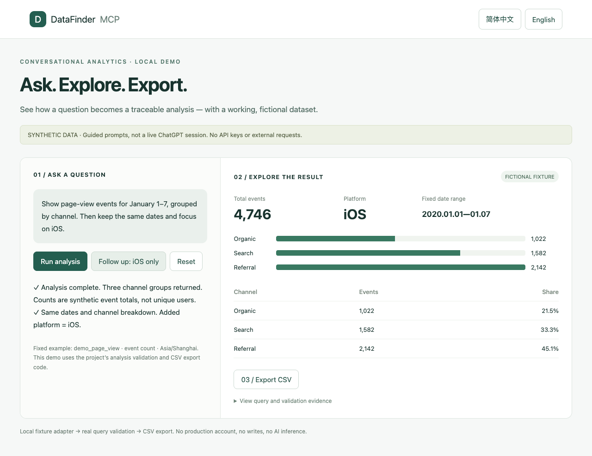

# DataFinder MCP installation and demo guide

[Full 52-tool standalone installation](../standalone/README.en.md)
[简体中文](INSTALL.zh-CN.md) · [Back to the README](../README.en.md)

## Choose your installation

For the full **52-tool standalone package 0.2.0**, use [the complete English guide](../standalone/README.en.md). It requires **Node.js 24+**, runs over stdio, uses its own SQLite database and supports a separate background worker. Both write switches default to false. It does not need D1 or a cloud login gateway. Install with `npm install @cyuanxv/datafinder-mcp@0.2.0`, or configure npx as described in the guide.

The browser demo below is a separate guided walkthrough with fictional data. The final cloud section describes the optional web workbench, not the standalone installation.

## Start with the local demo

No DataFinder keys, database, or ChatGPT account are needed. Guided prompt buttons invoke the project's actual query validation and CSV export code, with a local fictional fixture replacing upstream responses. The demo does not accept free-form prompts, call an AI model, or establish a live production connection.

### 1. Prepare your environment

Use Node.js 24 LTS and npm. Python 3 is also needed for the full test suite. Check your terminal:

```sh
node --version
npm --version
python3 --version
```

### 2. Extract the source and install dependencies

Extract the source archive into a directory of your choice. From the extracted `datafinder-source` directory:

```sh
cd site
npm ci
npm run demo
```

The initial dependency installation requires access to the npm registry. Once installed, the demo itself only accesses the local server.

When the terminal prints `Synthetic demo: http://127.0.0.1:4178`, open:

- English: `http://127.0.0.1:4178/?lang=en`
- Chinese: `http://127.0.0.1:4178/?lang=zh`

The server binds to loopback only. Keep this terminal open while using the local demo; press `Ctrl+C` to stop it. This is separate from running the full service in the cloud.

### 3. Complete the walkthrough

1. Click **Run analysis**: query the fixed period January 1–7, 2020, to see **9,912** fictional events grouped by channel.
2. Click **Follow up: iOS only**: keep the dates and breakdown, filter to iOS, and see **4,746** events.
3. Click **Export CSV**: download 21 detail rows (7 dates × 3 channels), each labeled `synthetic_data=true`.
4. Expand **View query and validation evidence** to inspect the `os_name = ios` condition and dates.
5. Click **Reset** to return to the initial state. Change language with the buttons at the top right.

These are event counts, not unique users. Screenshots come from this working local demo and contain no business data.



### 4. Run the checks

From `site`:

```sh
npm test
npm run typecheck
npm run build
```

Tests block network access through global fetch by default and require no real credentials. Do not connect a production database to run tests.

## Optional: deploy the cloud web workbench

This is a configuration path, not a one-click deployment. The cloud web-workbench source depends on a Sites / Cloudflare D1 runtime and a trusted identity gateway. Static website hosting alone cannot run all features.

1. **Create an isolated test environment.** Use a DataFinder test application with the necessary permissions and a separate D1 database. Do not reuse someone else's production database.
2. **Configure scope.** Edit [scope-config.mjs](../site/lib/datafinder/scope-config.mjs) with your PROJECT, APP, SUBJECT, DASHBOARD, REPORTS, and PUBLIC_BASE_URL. Obtain IDs from your own console; replace the fictional values.
3. **Provision server secrets.** Set DATAFINDER_AK, DATAFINDER_SK, and DATAFINDER_OWNER_USER_ID in the target platform's secret configuration. See [.env.example](../site/.env.example). This example file does not automatically load secrets. Never put keys in client-side code.
4. **Prepare D1.** Create the DB binding and apply the [drizzle migrations](../site/drizzle/) in numbered order to the new database. Commands and binding configuration depend on your platform; verify the destination before applying migrations.
5. **Configure the authentication gateway.** It must verify identity, strip externally supplied identity headers, inject trusted identity, and prevent direct origin access. DATAFINDER_OWNER_USER_ID must match the authenticated identity. See [Security](../SECURITY.md).
6. **Deploy and verify.** Use your platform's process to build the application, bind the database and secrets, and deploy to an isolated test URL. hosting.json contains no deployment ID; it does not establish an existing cloud project association.
7. **Connect ChatGPT.** In a client that supports custom MCP connections, configure your HTTPS URL with `/mcp` and complete the target platform's authorization flow. Availability and UI depend on the client and account. Check the connection, then compare a known report and date with the console.
8. **Accept features individually.** Unauthenticated users and other accounts must be denied data access. Check dates, time zones, definitions, and exports. Do not automatically approve metadata or cohort writes.

Keep `DATAFINDER_ALLOW_PROJECT_WIDE=false` by default. Deployment on arbitrary platforms has not been established by the local demo.

## Troubleshooting

| Symptom | What to check |
|---|---|
| Old Node version or SQLite test errors | Use Node.js 24 LTS and check the executable selected by your terminal |
| `npm ci` fails to download dependencies | Check registry access, proxy, and network settings; retain the lockfile rather than upgrading dependencies blindly |
| `EADDRINUSE` | Another process owns the port; do not terminate an unknown process. On macOS/Linux use `DEMO_PORT=4180 npm run demo`, then open port 4180 |
| Changing the port on Windows | In PowerShell run `$env:DEMO_PORT=4180`, then `npm run demo` |
| localhost is rejected | Use the `127.0.0.1` URL printed by the terminal; the demo restricts the Host header |
| `npm run dev` redirects to sign-in | The full workbench depends on platform authentication; use `npm run demo` for a credential-free walkthrough |
| Live account returns 401 | Check the trusted gateway and owner binding; do not remove authentication to bypass the error |
| Live results differ | Check permissions, dates, time zones, filters, and metric definitions; synthetic tests do not establish live API equivalence |

## Cover and demo assets

[English cover](../assets/cover.en.png) · [Chinese cover](../assets/cover.zh.png). Covers are concept illustrations; demo images are actual browser screenshots. Neither contains business data. Editable SVG sources are included; PNG covers are 1280 × 640.
