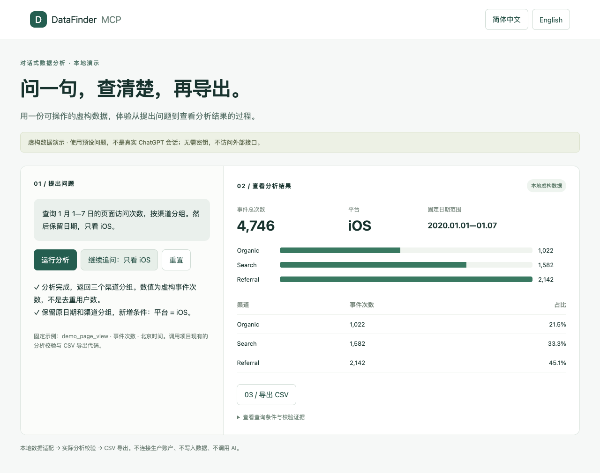

# DataFinder MCP 安装与演示指南

> 发布状态：源码和安装包通过 GitHub Release 提供。npm 上传连接超时，MCP Registry 登记尚未完成；请先使用下面的 GitHub 安装命令。
>
> `npm install https://github.com/cyuanxv/datafinder-mcp/releases/download/v0.2.0/cyuanxv-datafinder-mcp-0.2.0.tgz`

[完整 52 工具独立安装](../standalone/README.md)
[English](INSTALL.en.md) · [返回项目介绍](../README.md)

## 先选安装方式

使用完整 **52 工具独立安装包 0.2.0**，请按[独立安装教程](../standalone/README.md)操作。它要求 **Node.js 24+**，使用 stdio、自有 SQLite 和单独运行的后台程序；两个修改开关默认关闭，不需要 D1 或云端登录网关。使用上方 GitHub Release 安装命令；npm 发布完成后再使用 npx。

下面的浏览器演示是另一个使用虚构数据的体验入口。最后的云端章节只介绍可选的网页工作台部署，不是独立包安装步骤。

## 先跑本地演示

本地演示无需 DataFinder 密钥、数据库或 ChatGPT 账户。它提供预设问题按钮，调用项目实际的查询校验和 CSV 导出代码，由本地虚构数据代替上游响应。它不接收自由文本，不调用 AI，也不证明生产接口已连接。

### 1. 准备环境

建议使用 Node.js 24 LTS、npm；运行完整测试还需要 Python 3。在终端检查：

```sh
node --version
npm --version
python3 --version
```

### 2. 解压并安装依赖

将源码包解压到自己选择的目录，在解压后的 `datafinder-source` 目录执行：

```sh
cd site
npm ci
npm run demo
```

首次安装依赖需要访问 npm 注册源。安装后演示本身只访问本机服务。

终端出现 `Synthetic demo: http://127.0.0.1:4178` 后，在浏览器打开：

- 中文：`http://127.0.0.1:4178/?lang=zh`
- English：`http://127.0.0.1:4178/?lang=en`

服务仅绑定本机地址，保持终端开启；结束时按 `Ctrl+C`。这与需要持续运行的正式云端服务是两个独立场景。

### 3. 走完一次演示

1. 点击“运行分析”：固定查询 2020-01-01 至 2020-01-07，按渠道展示 **9,912** 次虚构事件。
2. 点击“继续追问：只看 iOS”：保持日期与分组，事件总数变为 **4,746**。
3. 点击“导出 CSV”：得到 21 行明细（7 天 × 3 个渠道），每行标注 `synthetic_data=true`。
4. 展开“查看查询条件与校验证据”，确认 `os_name = ios` 与日期条件。
5. 点击“重置”回到起始状态。右上角随时切换语言。

这里统计的是事件次数，不是独立用户数。截图来自这份可运行的本地演示，没有真实业务数据。



### 4. 运行检查

在 `site` 目录执行：

```sh
npm test
npm run typecheck
npm run build
```

`npm test` 默认阻止全局 fetch 联网；不需要真实凭证。请勿连接生产数据库执行测试。

## 可选：部署云端网页工作台

本节是配置路径，不是“一键部署”。云端网页工作台源码依赖 Sites / Cloudflare D1 运行环境及可信身份网关，普通静态网页托管不能直接运行所有功能。

1. **先建立独立测试环境。** 准备具有所需权限的 DataFinder 测试应用和独立 D1 数据库，不复用其他人的生产数据库。
2. **填写作用域。** 修改 [scope-config.mjs](../site/lib/datafinder/scope-config.mjs)，填写自己的 PROJECT、APP、SUBJECT、DASHBOARD、REPORTS 和 PUBLIC_BASE_URL。编号需来自自己的控制台，不能沿用虚构值。
3. **配置服务器密钥。** 在目标平台的秘密配置中设置 DATAFINDER_AK、DATAFINDER_SK、DATAFINDER_OWNER_USER_ID；变量格式见 [.env.example](../site/.env.example)。示例文件不会自动加载密钥，也不要把密钥放入前端。
4. **准备 D1。** 建立名为 DB 的绑定，对新数据库按编号顺序应用 [drizzle 迁移](../site/drizzle/)。具体命令和绑定方式取决于目标平台，先确认目的地再执行。
5. **接好登录网关。** 网关必须验证身份、清除外部传入的身份头并注入可信身份，同时阻止绕过网关直连源站。DATAFINDER_OWNER_USER_ID 必须与登录身份匹配。详见 [安全说明](../SECURITY.md)。
6. **部署并验证。** 通过目标平台提供的流程构建、绑定数据库和密钥，再发布到独立测试地址。hosting.json 没有预置部署 ID；不能把它视为已经关联了一个云项目。
7. **连接 ChatGPT。** 在支持自定义 MCP 连接的客户端配置你的 HTTPS 地址加 `/mcp`，完成目标平台的登录授权。实际入口和可用性取决于客户端与账户。先检查连接，再用一个已知日期和报表对照控制台。
8. **逐项验收后使用。** 未登录和其他账号应拒绝数据请求；核对日期、时区、口径和导出结果。不要自动批准元数据或分群写入。

默认保持 `DATAFINDER_ALLOW_PROJECT_WIDE=false`。在独立环境验收之前，不承诺任意平台均可直接部署。

## 常见安装问题

| 现象 | 处理方式 |
|---|---|
| Node 版本太低或 SQLite 测试报错 | 切换到 Node.js 24 LTS；检查终端实际使用的版本 |
| `npm ci` 下载失败 | 查看 npm 网络、代理和注册源；保留锁文件，不要随意升级依赖 |
| `EADDRINUSE` | 端口已占用；不要结束不认识的进程。macOS/Linux 可用 `DEMO_PORT=4180 npm run demo`，然后打开 4180 |
| Windows 更换端口 | PowerShell 执行 `$env:DEMO_PORT=4180`，再执行 `npm run demo` |
| 打开 localhost 出现拒绝 | 使用终端提示的 `127.0.0.1` 地址，演示限制 Host 为该地址 |
| `npm run dev` 跳到登录页 | 正式工作台依赖平台认证；无凭证体验请用 `npm run demo` |
| 接入后出现 401 | 核对可信网关与账号绑定；不要通过取消认证修复 |
| 云端数据不一致 | 核对账户权限、日期时区、过滤、统计口径；模拟演示不代表真实接口验收 |

## 封面和演示素材

[中文封面](../assets/cover.zh.png) · [英文封面](../assets/cover.en.png)。封面是功能概念图，演示图是浏览器实际截图；二者均不包含真实业务数据。封面保留可编辑 SVG 源文件，PNG 为 1280 × 640。
